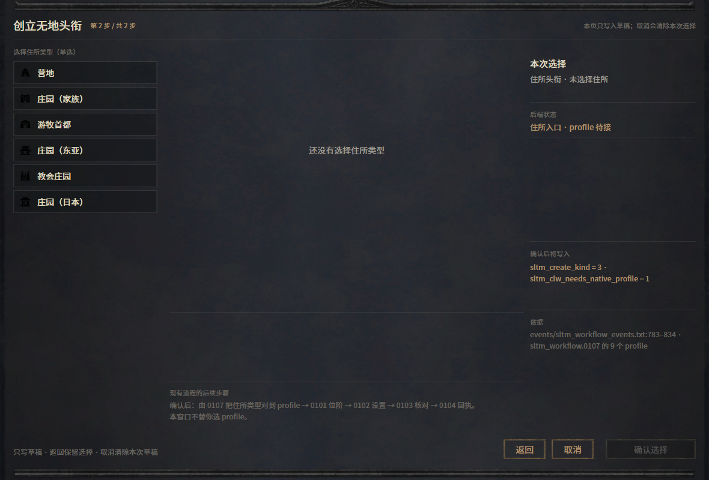
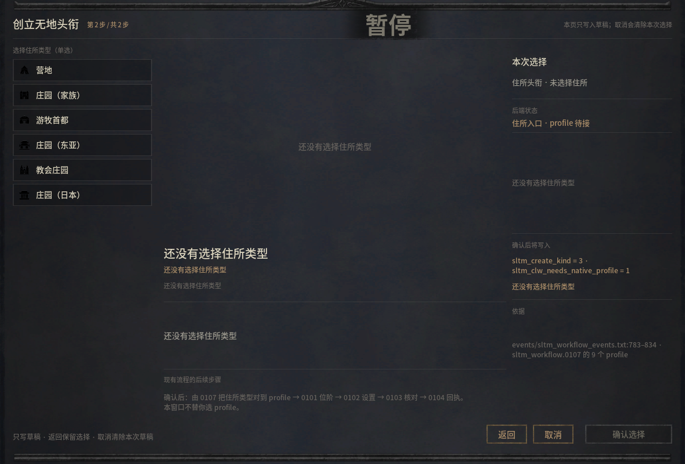
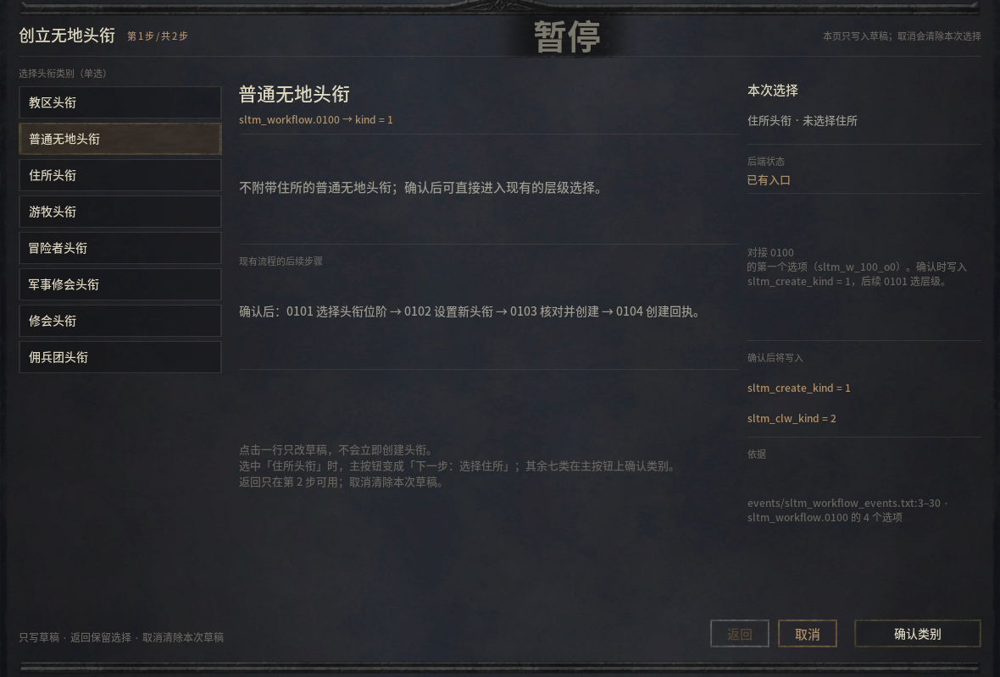

# 网页预览只提示一次，进游戏怎么出现七次？

「创立无地头衔」窗口的第一步选择头衔类别，选中住所头衔后进入第二步选择住所。离线预览里，未选住所时只显示一次提示；在 CK3 1.20.1.2 的简体中文新局中，同一句「还没有选择住所类型」出现了七次。

| 浏览器预览，未选住所 | CK3 实机，同一状态 |
| --- | --- |
|  |  |

本次测试在 Steam 正常启动后进行，游戏画面为 1920×1200、界面缩放 100%，网页画布为 1760×990。两图按同一窗口区域裁切。原生窗口在启动前已注册；进入第二页后先不选任何住所，截图，再选择「庄园（东亚）」、返回第一页，最后改选普通无地头衔。

**第一处错误在空值的显示规则。** 网页会清空其余字段，原生多个动态文案字段却都回退到同一条提示。七个位置是插图区、名称、ID、来源、描述、右栏说明和右栏 ID。复查时应逐个核对这些字段在空状态下应该返回空串、提示，还是隐藏自身。

**第二处错误在类别切换后的摘要。** 改选普通无地头衔后，左栏和中栏已显示普通无地头衔，右栏仍显示「住所头衔 · 未选择住所」。这一条摘要一直走住所分支。复查该状态时，要同时检查类别高亮、正文、右栏摘要和确认按钮。

几何和状态分开验收很重要。东亚庄园插图在两边都从 (572, 191) 开始，宽 590、高 314；第一页与返回后的三个底部按钮区域在游戏截图中逐像素一致。版式对齐的同时，上述两处文字仍有问题。这份记录保留错误出现时的版本，实际创建头衔和用户亲验没有在本例验收。[测量摘要](observations.json) · [本窗口的源码编辑](one-coordinate.md) · [研究目录](README.md)
