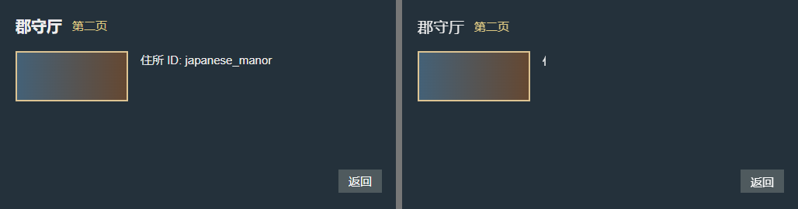
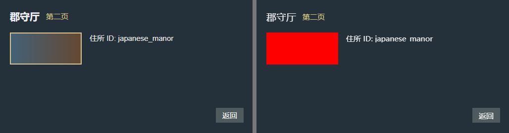
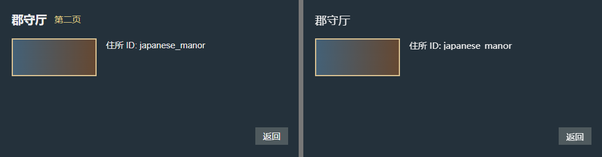

# 三个可运行的布局错误样例

用随库的「郡守厅」网页建立同一份基线，每次只改一处。比较图左边是浏览器显示的源网页，右边是浏览器读回故障副本的画面。它们全部是离线实验。

## 从仓库根目录运行

使用 Windows、Python 3.13 和本机 Edge 或 Chrome。先依照观窗的使用说明准备 Python 依赖。在 PowerShell 中运行下面两行。若已建专用虚拟环境，把 `py -3.13` 换成该环境的 Python。[依赖准备](../../../.agents/skills/guanchuang/SKILL.md)

```powershell
$output = Join-Path $env:TEMP ("guanchuang-layout-errors-" + [guid]::NewGuid().ToString("N"))
py -3.13 .\docs\research\errors\run_cases.py --out $output
```

成功运行会得到三张对照图和 `results.json`。三例都应报告 `REJECTED`，命中相应的诊断时代码以 0 退出。正常转换在发现结构错误后就停止；演示脚本为解释原因，另外用临时故障副本渲染右图。输出目录只保留诊断和对照图。

### 1. 文本框只有 4 像素宽

把 `value_text_1` 的宽度改为 4，住所 ID 可用的横向空间不足。报告指出 `TEXT_ALLOCATION`，受影响的源网页元素是 `value`。



### 2. DDS 还在，像素却被换掉

把 `swatch` 的渐变纹理换成一张 1×1 的红色 DDS，保留纹理路径。报告应为 `TEXTURE_PIXELS`；只检查文件是否存在会漏掉它。



### 3. 徽标跑到窗口外

把 `badge` 的横坐标移到 900。窗口仍可解析，回读画面中的「第二页」消失。实验要求命中 `NATIVE_BOX`；本次还报告了随徽标移动的 `TEXT_POSITION`。



[本次运行的完整诊断](results.json) · [复现脚本](run_cases.py) · [源网页](../../../source/tests/fixtures/visual_contract.html) · [观窗的回归测试](../../../source/tests/test_visual_output.py) · [研究目录](../README.md)
