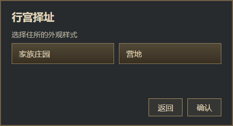
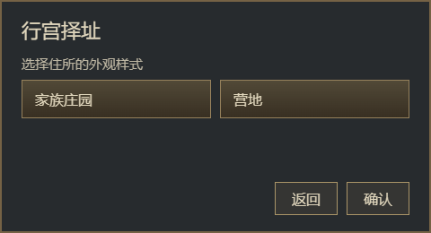

# 用「行宫择址」走一遍布局检查

随库网页在 1760×990 画布的 (96, 72) 放置一个 480×260 的「行宫择址」窗口，含两个住所选项和底部按钮。浏览器先测量当前状态的元素和文字行，观窗生成原生 `.gui` 与 DDS，再从这些输出构建可见预览进行对照。CSS 网格在这次取样中变成测得的位置和尺寸，按钮的玩法回调需要由 Mod 接入。[源网页](../../示例/外观草图.html)

从仓库根目录运行下面的 PowerShell 命令。依赖准备方法见随库说明。[运行环境](../../.agents/skills/guanchuang/SKILL.md)

```powershell
py -3.13 .\.agents\skills\guanchuang\scripts\run.py demo
```

| 源网页的窗口 | 从 `.gui` 和贴图回读的窗口 |
| --- | --- |
|  |  |

本次复跑检查了 9 个元素、6 行文字、5 个绘制层和 3 个 DDS 文件。整窗 RGB 平均绝对差为 1.162（每通道 0–255），报告给出 `VERIFIED_SCOPED`。生成的 `gc_palace.gui` 的 SHA-256 为 `78564de94e2c43aab53a26b65c1b136392f666738d133e36d41ea6f9dbb4cd93`。可从命令返回的 JSON 打开 `artifacts.gui`、`artifacts.gfx` 和 `artifacts.audit` 检查自己那一次的结果。字体和浏览器环境可能影响像素指标。

**这两张都是浏览器画面。** 在 CK3 中冷启动、注册并打开这份新窗口仍记 `NOT_RUN`。要验证游戏中的样子，下一项证据是同一生成文件、同一缩放和状态下的游戏截图。如何让布局报告准确指出错误，可以直接用故障样本练习。[可运行错误样例](errors/README.md) · [数据摘要](observations.json) · [研究目录](README.md)
