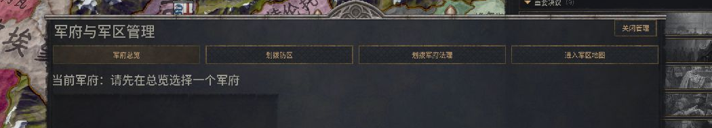
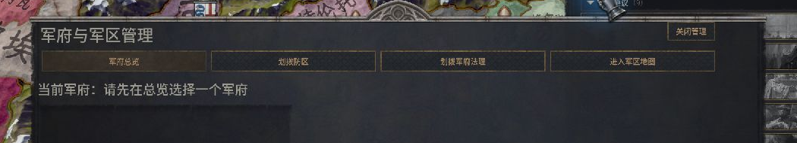
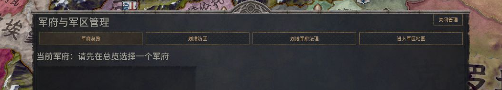

# 退出原生 GUI 编辑器后，窗口为什么还变宽了？

在 CK3 1.20.1.2（Crozier）的「军府与军区管理」窗口中，把根控件宽度从 1420 改到 1500，不点 Save，直接退出编辑器，画面仍显示较宽的外框。此时测试文件的 SHA-256 未变；执行 `reload gui` 后，外框恢复原宽。这个窗口的临时布局可以直接在游戏中预览。

**复现条件。** 从 Steam 经 Paradox Launcher 启动，测试副本在启动前就有可从决议打开的窗口。开 1066 玛蒂尔达新局并暂停。第一组用 `-debug_mode -develop`，在官方编辑器中选中 `cmm23_manager` 根控件。原生树提示 `gui/cmm23_manager.gui:2`；用 Go to file 核对测试副本，再改根的 `size` 宽度，高度保持 800。共享类型没有参与写入。

| 原宽 1420 | 未保存，退出编辑器后宽 1500 |
| --- | --- |
|  |  |

两张图来自同一块 1280×800 游戏画面。在原图中，左右边缘约从 x=182、1098 移到 x=155、1125。属性改了 80 个布局单位，在这个截图尺度下可见宽度约增加 53 像素。

## 点 Save 后发生了什么

第二组冷启动沿用同一窗口，启动选项额外加入 `-gui_editor_preserve_comments`。先确认目标路径与备份，只点一次 Save。编辑器确实写到了指定的测试文件。输出长 121449 字节，含 22344 个 NUL 字节，UTF-8 解码在偏移 167 首次失败。

这次保留了原始输出直接重载。日志确认游戏重新读了该文件，控制台也确认完成重载，但窗口消失，再从原决议打开仍未显示。恢复原文件并显式重载后，窗口及原宽重现；恢复文件的 SHA-256 为 `30269975fb20f27d36b6f8d640d335cb6a8bf8e3b5680add1dc3d06817de0fe5`。

这一例查明了写入目标、文件异常和引擎重载的实际结果。故障原因仍未知，该结果只覆盖这个版本、窗口及启动条件。复查其他窗口时，把“画面是否变化、目标文件是否变化、引擎是否重读、窗口能否重新打开”分别记下来，才能知道失败发生在哪一步。需要保存单一显式属性时，可参考观窗的字节差分案例。[一个标签、一行差分](one-coordinate.md) · [实测数据](observations.json) · [研究目录](README.md)
