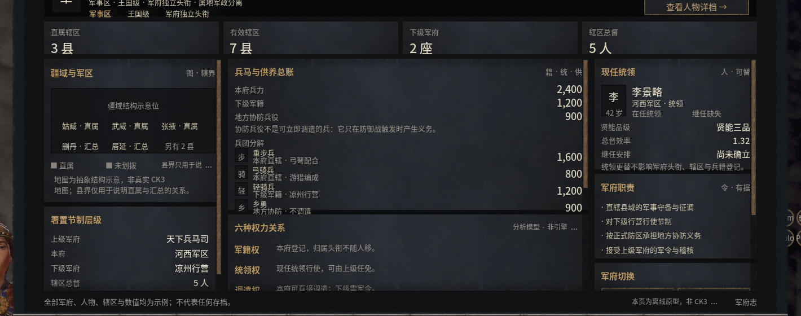
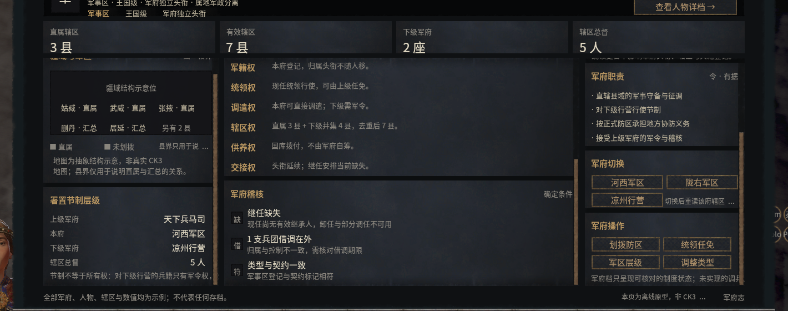

# 军府窗口的三栏滚动实验

同一扇军府窗口里，左、中、右栏各有滚动条。在这个版本的样本中，从顶部滚到底，原生内容分别位移 **29、321、195 像素**。如果只检查中栏，另外两栏的边界错误很容易漏掉。

| 原生三栏在顶部 | 原生三栏在底部 |
| --- | --- |
|  |  |

## 怎么测

1. 固定窗口、缩放与页面状态。截顶部图，为每一栏选定相同的内容区域；保留能确认滚动边缘的文字或边线。
2. 将指针放在一栏，逐次滚轮向下，到底再多滚一次。记录本栏内容位移，同时检查另外两栏是否变化。对三栏重复这一过程。
3. 反向滚回顶部，把三块内容分别与起始图比较。这轮共执行 28 次滚轮操作。操作目标栏时，另外两栏的位移为零；回顶后三块内容区域的变化像素均为零。窗口外的动画仍会变化，因此整张截图的散列不适合当回顶判据。

## 两个能复查的差异

浏览器在本样本的 150% 内部布局尺度下，到底时还差约三分之一个 CSS 像素。改为游戏实测的整数逻辑偏移后，再用三栏各自的终点核对。滚动条材质的中段则因为 CSS 平铺而改变了图案周期。保留两端各 3 像素、中段按原 34 像素周期平铺后，六组滑块区域的平均色差由 7.81–9.20 降至 0.93–2.95（每通道 0–255）。

这些数字属于这一次军府窗口的资源和布局。移植到自己的窗口时，复用三栏分别滚到底、回顶、检查旁栏的步骤，用自己的实测数值作基准。该记录覆盖有限滚动行为和局部材质，完整窗口仍有采样与合成差异。[测量摘要](observations.json) · [研究目录](README.md)
