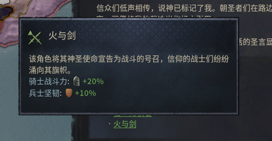
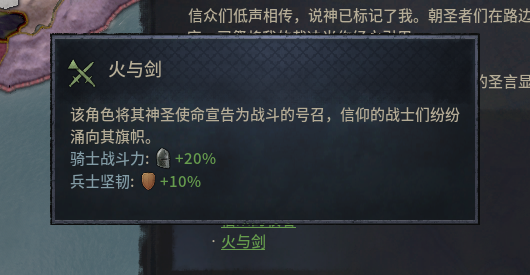

# 鼠标回到同一像素，提示框也会回到原位吗？

在 CK3 的「火与剑」提示框上，两次把指针移到同一个 (612, 647)。先经过 (650, 620) 时，提示框左边缘估计在 x=401；先经过 (624, 647) 再回来时，估计在 x=415。两次的终点相同，提示框横向相差 14 像素。

| 从 (650, 620) 移到终点 | 从 (624, 647) 移到终点 |
| --- | --- |
|  |  |

两张图使用 1760×990 原生画面的同一裁切区域。位置由独立边框素材与原生截图匹配估计，两个选定位置的不透明区域平均色差约为 0.455/255。原生编辑器没有在这项实验中输出控件矩形。候选框的纵坐标约 438.5，估计宽 430、高 192。

**已经排除的解释。** 只用最后的鼠标坐标加一个固定偏移，无法同时产生这两个观察结果。**仍待解释的现象。** 哪些位置、停留时间或内部状态参与选边还不清楚。局部不透明边框能对齐，完整半透明边框和网页悬停位置仍未通过原定门槛。

复查时应记录进入目标前的路径、每个落点、视口、可见提示内容及对应截图。先固定其他条件，交替重放两条路径，再从单一变量区分可能解释。这篇作为开放研究笔记，保留两个可核对的原始画面摘要。[截图来源](image-sources.json) · [位置估计](observations.json) · [研究目录](README.md)
